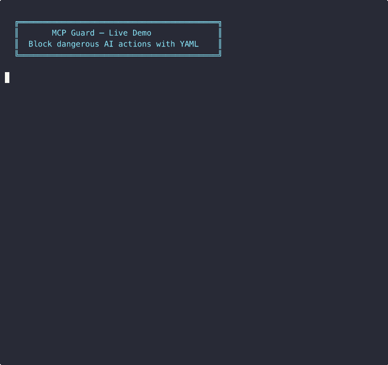

# MCP Guard

MCP Guard is a free guard for coding agents: it checks each shell command and file edit before it runs, stops the destructive ones, and sends them to a named person who signs in Permission Protocol; only a verified, signed receipt releases the call. Claude Code is supported first.

## Install for Claude Code

In your Claude Code project (a directory with `.claude/` or `CLAUDE.md`):

```bash
npx @permission-protocol/mcp-guard init --preset coding-agent
```

In any other directory, add `--hook claude-code` to install the hook there anyway:

```bash
npx @permission-protocol/mcp-guard init --preset coding-agent --hook claude-code
```

Without either, `init --preset coding-agent` installs the hook only in a Claude Code project; outside one, with no MCP server to wrap, it exits 1 and tells you to pass `--hook claude-code`. `--no-hook` skips the hook. `init --help` lists every option.

### What happens next

1. **Checks first, so a refusal changes nothing.** init refuses before logging in if `pp.config.yaml` exists and does not load, if `.claude/settings.json` is not valid JSON, if on Windows it finds no Git Bash, if the hook launcher (below) cannot start the guard, or, when it will wrap an MCP server, if the command the client would run (`npx -y @permission-protocol/mcp-guard@<this version>`, or `--wrap-launcher <cmd>`) does not report this exact version.
2. **Connect in the browser.** init prints a Permission Protocol link and a pairing code, and opens the link in your browser. Check that the page shows the same code and choose Connect (you need the owner or admin role in the workspace). In a terminal, init then asks you to confirm the workspace name. The install token goes to the OS keychain, or to a file restricted to your user ([where](#where-the-token-and-keys-are-kept)), and is never printed. If a token is already stored and there is no MCP server to wrap, init reuses it and skips the login.
3. **Local setup.** A signing key is created if there is none; the `coding-agent` policy is written to `pp.config.yaml` (an existing one that loads is kept byte for byte); the `PreToolUse` hook is added to `.claude/settings.json`. If Claude Code or Cursor has an MCP server configured that is not wrapped yet, init also wraps one (it asks which when there are several; the client config is copied aside first).
4. **Hook self-test, local.** One allowed call (`git status`) and one held call (`terraform destroy -auto-approve`) are run through the installed hook. Nothing is sent and nothing runs. If a check fails, init exits 1 and says whether the test could not run (which says nothing about the hook) or the installed hook answered wrongly (it stays installed and fails closed, so guarded calls may be blocked until it works). Either way it prints the undo command, `<launcher> hook uninstall --project <dir>`.
5. **First signature.** init holds a do-nothing call, prints a signing link and opens it in your browser. Sign it in Permission Protocol; init prints the signed receipt and the command that verifies it again. `--skip-self-test` skips this step.

init then prints, in this order: what is guarded and where the policy is; what happens the next time an agent tries something destructive; `mcp-guard report` and the receipt verify command; how to undo each change; and the setup details.

Restart Claude Code so it loads the hook. Commit `pp.config.yaml` and `.claude/settings.json` to guard every teammate's session; add `pp-receipts.jsonl` (the receipt log, beside the policy) to `.gitignore`. Running init again sets up only what is missing; when the token, key, policy and hook entry are all in place (and there is no server to wrap) it says `Already set up` and exits 0.

**The launcher.** The hook starts the guard with `npx --no-install mcp-guard` when the package is installed in the project, otherwise with `npx -y @permission-protocol/mcp-guard@<exact version>`, pinned in `.claude/settings.json`. With the `npx -y` launcher the first guarded call in a session may download the package. Installing it in the project (`npm install --save-dev @permission-protocol/mcp-guard`) before running init avoids the download.

Details: [docs/hooks.md](docs/hooks.md#set-up-with-init---preset-coding-agent).

## What is guarded

The hook sees Claude Code's `Bash`, `PowerShell`, `Write`, `Edit` and `NotebookEdit` calls. The `coding-agent` preset holds these for a signature (the same rules apply to MCP tools when the preset guards a wrapped server):

| Rule | Holds |
|------|-------|
| `destructive-shell` | `rm -rf` outside the working tree, force pushes and pushes to `main`, disk writes, destructive SQL through `psql -c` and similar |
| `destructive-sql` | `DROP`, `TRUNCATE`, `DELETE` / `UPDATE` without `WHERE`, in the SQL argument of an MCP database tool (`sql`, `query`, ...) |
| `terraform-destroy` | `terraform destroy`, `apply -destroy`, `apply -auto-approve` without a saved plan |
| `cloud-delete` | Cloud and Kubernetes deletes of databases, volumes, buckets, snapshots, clusters, namespaces |
| `production-target` | Any call naming a production target you list under `targets:` (empty by default, so it matches nothing until you add names) |
| `guard-tamper*` | Changes to the guard itself: its policy, receipt log, keys, install token, the hook entry and Claude Code settings files, killing it |

Secret reads (`cat .env`, `printenv`, token printers) are recorded only (`secret-read` has `observe: true`) until you delete that line. A command the detectors cannot read (`eval`, `python -c`, `curl | sh`) is held. Everything else runs, and Claude Code's own permission prompts still apply to it: the guard only adds restrictions.

### What a held call looks like

A held call waits in the hook for up to 240 seconds (`--wait`). While it waits:

- **The signing page opens in your browser**, once per request, where a named person chooses Sign or Reject. Only an `https:` page on the origin of the policy's `cloud.api_url` is opened, with no shell. It is not opened when `CI` is set, in an SSH session, on Linux without a display, with `MCP_GUARD_OPEN_BROWSER=off`, or with `open_browser: false` under `cloud:`.
- **Claude Code shows the hook's status message** beside its spinner: `mcp-guard is checking this call. If it is held, it waits here for a named person to sign it in Permission Protocol, and the signing page opens in your browser when it can.` Claude Code reads a hook's output only when it ends, so the link itself is not shown during the wait.

Then:

- **Signed in time:** the call runs. Claude is told, and you see, `Approved by <name> through Permission Protocol. Receipt: <link>`. The name comes from the verified receipt.
- **Not signed in time:** the call is denied. Claude gets the signing link: `mcp-guard: held by rule "terraform-destroy" (terraform_destroy: destroy) for a Permission Protocol signature; nobody signed within the hook's 240-second wait. Request <id> stays open for up to 600 seconds: sign it at <link>. After it is signed, run exactly the same call again; ...`. You see the link too, with the fact that the same call can be retried after someone signs. The retry resumes the same request and does not open a second tab.
- **Rejected, expired, or anything that fails verification:** denied. Changed arguments do not match the signed receipt and are denied.

The receipt is verified offline against Permission Protocol keys pinned in the package, and redeemed once, before the call is released.

## What it does not catch

The detectors are heuristics that stop mistakes. They are not a sandbox.

- **Scripts in files.** Anything run from a file (`./cleanup.sh`, `python x.py`, `make`, `npm run`) is not read. An agent can write a file in one call and run it in the next.
- **Removing the hook.** An agent running as the same OS user can, by a route the detectors do not read (a script, for example), edit the settings file or the policy and switch the guard off. Run untrusted agents as a separate OS user that cannot write the guard's files.
- **Tools the hook does not see.** Reads and searches are not sent to the guard. MCP tools (`mcp__...`) are not matched by the hook; wrap those servers with the proxy (below).
- **Context that needs I/O**: the current git branch, the current kube context, what a variable or glob expands to, plan files and manifests.
- **Windows** needs Git for Windows: Claude Code runs the hook through Git Bash, and so does init's check. init finds it without Git's `bin` on PATH (`CLAUDE_CODE_GIT_BASH_PATH`, PATH, the standard install folders, beside `git.exe`) and refuses the hook step if it cannot.
- **Claude Code before 2.1.295** ignores the hook's `onFailure: "block"`. The installed command's own wrapper still blocks when the guard cannot run; the one case left is a hook that Claude Code kills at its own timeout, which on those versions lets the call through, and the guard's watchdog denies before that timeout. init prints a line if `claude --version` is older.
- **The first guarded call may download the package** with the default `npx -y` launcher (see above).
- Each guarded call starts a process through the launcher, which adds latency ([measured in docs/hooks.md](docs/hooks.md#limits)).

The full lists: [docs/presets.md](docs/presets.md) and [docs/detectors.md](docs/detectors.md#known-limits).

## What is sent to Permission Protocol for a held call

Only for a held call that waits for a signature (allowed and blocked calls send nothing): the tool name, the server label (`claude-code` for the hook), the agent id, the environment label, the SHA-256 hash of the arguments, a **preview of the arguments that the guard masks and caps before sending**, and **why the call was held**: the matched rule's id (`ruleId`) and what its detector found (`effect`: the detector name, the kind of finding, whether the argument could be read, and the target it found, masked the same way and capped at 120 characters). For a `Bash` call the preview is the command; for `Write` or `Edit`, the file path and as much file content as fits.

- Masked on this machine: values under credential-like keys, private key blocks, credentials in URLs, Bearer and Basic values, common token formats (GitHub, OpenAI, Anthropic, AWS key ids, Stripe, Slack, JWTs and others), `password=` / `token=` / `.env`-style assignments with secret-looking names, and long opaque strings. Pattern-based: a short secret with no telling name (`mysql -pS3cret`) is not recognised.
- Short fields first, then capped at 2,048 bytes, so the cap cuts file content, not the path.
- Permission Protocol masks and caps it again before storing it. The signature covers the hash of the exact arguments, never the preview.
- To send the hash only, put `args_preview: false` under `cloud:`. The signer then sees the tool, server, agent and environment, the rule id, and the detector's name and kind of finding, not what the call does: neither the preview nor the target is sent.
- None of this is part of what is signed. The signature covers the hash of the exact arguments.

Details: [docs/hooks.md](docs/hooks.md#what-the-hook-answers).

## Usage heartbeat

**On by default.** With a `cloud:` section in the policy (init writes one) and an install token, the guard sends Permission Protocol the day's totals so far, at most one attempt every 10 minutes (the last one per UTC day counts), from a separate process that cannot allow, block or delay a call. It carries only: the guard version, a fixed client label (`claude-code`, `mcp-proxy` or `mcp-guard`), the mode, the day, six counts (`allowed`, `blocked`, `held`, `approved`, `denied`, `expired`), and how many calls each **built-in** rule id (the `coding-agent` preset's) blocked or held. Your own rule ids, arguments, commands, paths, file contents, tool, server and target names, hostnames and usernames are never sent.

```bash
npx @permission-protocol/mcp-guard heartbeat --show   # print exactly what would be sent today; sends nothing
```

Turn it off with `MCP_GUARD_HEARTBEAT=off` in the guard's environment, or with `heartbeat: false` under `cloud:` in the policy. Details: [docs/heartbeat.md](docs/heartbeat.md).

## What it decided: `mcp-guard report`

```bash
npx @permission-protocol/mcp-guard report               # last 7 days of the log beside ./pp.config.yaml
npx @permission-protocol/mcp-guard report --config path/to/pp.config.yaml --json
```

Per UTC day and in total: allowed, blocked, held, approved, denied, expired, the rules that blocked or held most, and observe-only matches. It reads the local receipt log only (`PP_SHARED_RECEIPTS_PATH` if set, else `pp-receipts.jsonl` beside the policy), sends nothing, and never prints arguments.

## MCP servers: the proxy

The same policy also runs as a stdio proxy between an MCP client and an MCP server. Every `tools/call`, `resources/read`, `prompts/get` and unknown method goes through the rules; only protocol plumbing (`initialize`, `ping`, list calls, notifications) passes untouched. Blocked calls get `-32001`; held calls wait for a signature (with a `cloud:` section) or for the local approval UI.

```bash
npm install @permission-protocol/mcp-guard
npx mcp-guard keys init            # once: every decision is signed; the guard never creates a key itself

cat > pp.config.yaml << 'EOF'
default_action: allow
rules:
  - { id: block-delete, tool: delete_user_data, action: block }
  - { id: hold-deploy, tool: deploy_production, action: require_approval }
EOF

npx mcp-guard --config pp.config.yaml -- node my-mcp-server.js
```

`npx @permission-protocol/mcp-guard init` (without `--preset`) does this for an MCP server already configured in Claude Code or Cursor: it connects to Permission Protocol, wraps the server you pick (the client config is copied aside first), writes a policy that holds one tool, and holds a test call for your first signature. The client then starts the guard with `npx -y @permission-protocol/mcp-guard@<this version>`; init checks that command reports this version before changing anything. To start it another way (a project install, a source checkout), pass `--wrap-launcher "<command>"`, for example `--wrap-launcher "node <checkout>/bin/mcp-guard"`: words are split on spaces, double quotes group a path with spaces, and the client runs it without a shell.

Proxy options: `--config <path>`, `--agent-id <id>`, `--operator <name>`, `--mode enforce|observe`, `--approval-port <port>` (local approval UI on 127.0.0.1, with a per-process token in the printed URL). Without a `cloud:` section the guard is local-only and says so: approvals are made on this machine and name `--operator`, not a signed-in person.

<p align="center">
  
</p>

`npx @permission-protocol/mcp-guard demo` runs the proxy demo with a throwaway demo key; gates refuse its receipts.

## Policy reference

```yaml
# pp.config.yaml
default_action: block        # allow | block | require_approval, when no rule matches
mode: enforce                # enforce (default) | observe: record, never block
server_label: github-mcp     # names the MCP server in receipts (default "mcp-server")
cloud:                       # held calls need a named person's signature in Permission Protocol
  environment: production    # development | staging | production: a label for the signer
  approval_timeout_seconds: 600
  # heartbeat: false         # turn the usage heartbeat off
  # args_preview: false      # held calls send the argument hash only, no masked preview or target
  # open_browser: false      # a held call does not open the signing page in this machine's browser
targets:
  databases: [prod-db.internal]
rules:
  - { id: hold-deploy, tool: deploy_production, action: require_approval }
  - { id: hold-reads, method: resources/read, action: require_approval }
  - { id: shell, tool: "*", detect: { detector: shell_destructive, args: [command] }, action: require_approval }
  - { id: prod-sql, tool: run_sql, match: { database: { equals: prod } }, action: block }
  - { id: prod, tool: "*", mentions_target: { args: [command, sql] }, action: require_approval }
  - { id: secrets, tool: "*", detect: { detector: secret_read, args: [command] }, action: block, observe: true }
```

Rules are tried in order and the first match wins. The loader is strict: an unknown key, a duplicate rule or an unreachable rule fails at startup. Other keys: `approval_ttl_seconds`, `receipt_ttl_seconds`, `scoped_receipt_ttl_seconds`, `signing`, and per rule `reversibility`, `countdown_seconds`, `cap_usd` with `amount_arg`, `receipt_ttl_seconds`. Argument rules and detectors: [docs/detectors.md](docs/detectors.md). Targets, `observe` and the preset: [docs/presets.md](docs/presets.md).

## Receipts and verification

Every final decision (allowed, blocked, approved, denied, released by countdown, expired) is an Ed25519-signed receipt in the Permission Protocol receipt standard (`jcs_v2`), appended to `pp-receipts.jsonl` as `{ "artifact": ..., "record": ... }`. The signed record names the tool, method, server label, rule, scope and who decided; arguments are bound only by `inputHash`, never stored. A held call is recorded unsigned until it is decided; a Permission Protocol signature is logged as a `{"cloud": ...}` line with the signed receipt.

```bash
npx @permission-protocol/mcp-guard keys show            # key id, keys.json path, the --trust value (also: keys init | rotate | revoke <key id>)
npx @permission-protocol/mcp-guard receipt verify <receipt id> --receipts-path pp-receipts.jsonl   # re-check a logged Permission Protocol receipt offline
npx @permission-protocol/mcp-guard verify --receipt-file receipt.json --keys .pp/keys.json \
  --trust "$MCP_GUARD_TRUST" --scope deploy:production --scope-sha "$GITHUB_SHA"
```

`verify` trusts only the key set you give it (and, with `--trust`, only the pinned key), requires a signed, unexpired `APPROVED` status, and matches scope exactly: a receipt naming a `scope.ref` or commit the gate did not ask for is refused, so pass `--scope-ref` when receipts carry one. It refuses demo-key receipts (`--allow-demo`), receipts no person approved for a scoped action (`--allow-policy-approval`) and 0.2 receipts (`--accept-legacy --pubkey <pem>`). `--call call.json` (`{"tool", "operation", "resource", "input"}`, `resource` required) binds the receipt to one exact call; `--require-call` makes it mandatory. Exit 0 authorized, 1 refused, 2 missing input. `npx @permission-protocol/verify` checks the same artifact.

## Where the token and keys are kept

| | macOS | Linux | Windows |
|---|---|---|---|
| Install token | Keychain | Secret Service (`secret-tool`), else a 0600 file `install-token` | The file `install-token` (below) |
| Private signing key | 0600 file | 0600 file | A file (below) |

- Files live under `~/.config/mcp-guard/` (`$XDG_CONFIG_HOME/mcp-guard/` if set; keys in `keys/`, or `$PP_KEYS_DIR`); on Windows that is `%USERPROFILE%\.config\mcp-guard\`. `PP_INSTALL_TOKEN` in the environment takes precedence over both stores.
- On macOS and Linux the guard refuses a token file or private key that other users can read.
- **Windows uses a file for the token because the guard has no Windows keychain (Credential Manager) integration.** File modes do not apply there, so after writing the token and the private key, the guard runs `icacls` to remove inherited permissions and grant only the current user. init prints whether that worked; if `icacls` is missing or fails, the files are protected only by the permissions of your user profile folder. The Windows path has been tested with a stand-in for `icacls` only, not on a real Windows machine.
- The token has the single scope `mcp:guard`: it can open, read and redeem this install's own approval requests, and cannot approve anything. The wrapped MCP server is started without any `PP_*` variable.

## CI gate

`templates/github-actions/receipt-gate.yml` is a deploy workflow that verifies a receipt before deploying, taking the verifier, key set, pin and receipt only from trusted places. Commit the key set (`cp ~/.config/mcp-guard/keys/keys.json .pp/keys.json`), set the `MCP_GUARD_TRUST` repository variable to the `--trust` value from `mcp-guard keys show`, and copy the workflow. A `github:merge` receipt binds the PR's head commit: gate it with `--scope github:merge --scope-ref refs/pull/<n>/merge --scope-sha <head sha>`.

## CLI

```
mcp-guard init [--preset coding-agent] [--hook claude-code | --no-hook] [--wrap-launcher <cmd>] [options]   # see init --help
mcp-guard hook [install | uninstall]          # docs/hooks.md
mcp-guard report [--config <path>] [--receipts <path>] [--json]
mcp-guard heartbeat --show | --send           # docs/heartbeat.md
mcp-guard [--config <path>] [--agent-id <id>] [--operator <name>] [--mode enforce|observe] [--approval-port <port>] -- <server command>
mcp-guard keys init [--demo] | keys rotate [--demo] | keys revoke <key id> | keys show
mcp-guard receipt verify <receipt id> [--receipts-path <file>] [--config <policy.yaml>]
mcp-guard verify --receipt-file <path> --keys <keys.json> --trust ID=sha256:<hex> --scope s [--scope-ref r] [--scope-sha h]
mcp-guard export-key [out.pem]                # legacy 0.2 public key only, for --accept-legacy
mcp-guard demo
mcp-guard --version
```

Security reports: [SECURITY.md](SECURITY.md). Changes: [CHANGELOG.md](CHANGELOG.md).

## License

MIT
