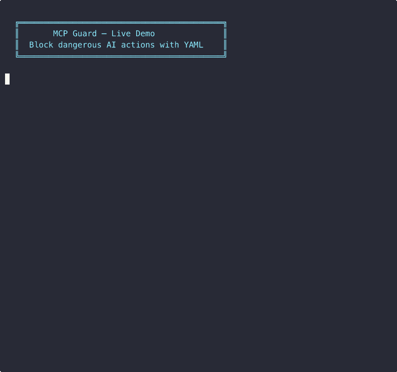

# MCP Guard

**Stop your AI agents from doing dangerous things.**

[MCP](https://modelcontextprotocol.io) (Model Context Protocol) is how AI agents call tools — like APIs, databases, or deployments. MCP has no built-in access control. MCP Guard adds that layer.

Define what's allowed, blocked, or requires approval — in a single YAML file. MCP Guard sits between your MCP client and server, enforces the rules, and records every decision as a signed receipt.

Every tool call, resource read and prompt fetch goes through your policy; only protocol plumbing (`initialize`, `ping`, list calls, notifications) passes untouched. **MCP Guard does not just log — it blocks execution before it happens.**

→ **Blocks** unsafe tool calls before they execute
→ **Holds** sensitive actions for human approval
→ **Signs** every decision as an Ed25519 receipt that names who authorized it
→ **Observe mode** — audit what would be blocked before enforcing

<p align="center">
  
</p>

## Get Started (2 minutes)

```bash
# Install
npm install @permission-protocol/mcp-guard

# Create a policy file
cat > pp.config.yaml << 'EOF'
default_action: allow
rules:
  - id: block-delete
    tool: delete_user_data
    action: block
  - id: hold-deploy
    tool: deploy_production
    action: require_approval
EOF

# Run your MCP server through the guard
mcp-guard --config pp.config.yaml -- node my-mcp-server.js
```

That's it. Your agent can no longer delete user data. Production deploys require approval. Every decision is signed and logged to `pp-receipts.jsonl`.

`default_action: allow` lets any tool without a rule run, and the guard warns about it at startup. Use `block` or `require_approval` to fail closed.

## 60-Second Demo (no MCP server needed)

See MCP Guard block dangerous tool calls in real-time, no setup required:

```bash
npx @permission-protocol/mcp-guard demo
```

## Architecture

```
┌────────────┐     stdio      ┌─────────────┐     stdio      ┌────────────┐
│  MCP Client│ ──────────────▶│  MCP Guard   │──────────────▶ │ MCP Server │
│  (Claude,  │                │  (proxy)     │                │ (your app) │
│   Cursor)  │ ◀──────────────│              │◀────────────── │            │
└────────────┘   responses    └─────────────┘   responses    └────────────┘
                                    │
                                    ▼
                              pp-receipts.jsonl
                              (audit trail)
```

MCP Guard parses every JSON-RPC message on stdin and forwards only what it parsed and evaluated, re-serialized:

1. A line that is not a single JSON-RPC 2.0 object (invalid JSON, a batch array, a malformed frame) gets an error and is never forwarded.
2. Plumbing passes through: `initialize`, `ping`, `notifications/*`, `tools/list`, `resources/list`, `resources/templates/list`, `resources/unsubscribe`, `prompts/list`, `logging/setLevel`, `completion/complete`.
3. Everything else — `tools/call`, `resources/read`, `prompts/get`, `resources/subscribe` and any method MCP Guard does not know — is decided by the rules, then `default_action`.
4. **Allowed** → forwarded (agent metadata under `_pp` is stripped first). **Blocked** → error `-32001`. **Held** → waits for a human (or returns `-32002` without an approval UI).
5. Every decision emits a signed receipt (one stderr line + `pp-receipts.jsonl`).

## Config Reference

```yaml
# pp.config.yaml
default_action: block        # allow | block | require_approval — when no rule matches
mode: enforce                # "enforce" (default) or "observe" (log only, never block)
approval_ttl_seconds: 900    # held requests expire after this (default 900)
receipt_ttl_seconds: 900     # signed receipts expire after this (default 900)

rules:
  - id: unique-rule-id       # unique identifier
    tool: tool_name          # exact tool name (tools/call rules)
    action: allow            # allow | block | require_approval

  - id: hold-reads
    method: resources/read   # govern another method (no "tool" field)
    action: require_approval

  - id: hold-email
    tool: send_email
    action: require_approval
    reversibility: reversible  # reversible | irreversible (default: irreversible)
    countdown_seconds: 300     # reversible only: auto-release unless someone holds it

  - id: spend
    tool: spend
    action: require_approval
    cap_usd: 50                # under the cap: runs now, shows in Verify; at/over: hard stop
    amount_arg: amount_usd     # required with cap_usd: the argument the tool actually charges
```

The loader is strict: an unknown key, a duplicate rule, a countdown on an irreversible rule, or `cap_usd` without `amount_arg` fails at startup instead of being ignored. A missing or non-numeric amount is a hard stop. Agent metadata under `_pp` (`confidence`, `requires_input`) can route a card to a different lane but can never turn a held or blocked call into an allowed one.

### Modes

| Mode | Behavior |
|------|----------|
| `enforce` | Block/hold tool calls per rules (default) |
| `observe` | Log decisions + emit receipts, but always forward (dry-run) |

Use `observe` mode to audit what *would* be blocked before turning enforcement on. Switch via config or CLI: `--mode observe`.

### Actions

| Action | Behavior | JSON-RPC Error Code |
|--------|----------|-------------------|
| `allow` | Forward request to server | — |
| `block` | Reject immediately | `-32001` |
| `require_approval` | Hold for approval (or reject without an approval UI) | `-32002` |

Other errors the agent can receive: `-32003` denied by a human, `-32004` approval request expired, `-32005` release refused (receipt failed verification), `-32700` / `-32600` / `-32602` malformed input.

## Receipts

Every decision produces a signed receipt (v2): a small **envelope** that is signed, plus a **display** block for people that is not.

```json
{
  "envelope": {
    "v": 2,
    "receipt_id": "rcpt_mg_mvtj9td5_63c091bfe0e7",
    "method": "tools/call",
    "tool": "deploy",
    "args_sha256": "<sha256 of the canonical arguments the server received>",
    "scope": { "scope": "deploy:production", "ref": null, "sha": "a1b2c3d4" },
    "decision": "allowed",
    "approval": { "kind": "human", "id": "rod", "via": "local-token" },
    "actor": "my-agent",
    "rule_id": "deploy",
    "policy_sha256": "<sha256 of pp.config.yaml>",
    "mode": "enforce",
    "issued_at": "2026-10-29T15:30:00.000Z",
    "expires_at": "2026-10-29T15:45:00.000Z",
    "nonce": "<random>",
    "key_id": "pp-dev-3c1d2e4f5a6b7c8d"
  },
  "signature": { "alg": "ed25519", "key_id": "pp-dev-3c1d2e4f5a6b7c8d", "value": "<hex>" },
  "display": { "summary": "…", "reason": "…", "risk_tier": "high", "target_server": "node server.js", "arg_keys": ["env", "sha"], "viewer_url": "…" }
}
```

- The signature covers `pp-mcp-guard-receipt-v2\n` + canonical JSON of the whole envelope, so no authority field can be edited or re-split.
- `approval` says who authorized the action: `human` (the approval UI operator) or `policy` (a rule, a standing spend cap, or a countdown).
- Receipts never contain raw arguments — only `args_sha256` and the argument names. Raw arguments appear only in the authenticated approval UI.
- The signing key lives in `~/.config/mcp-guard/keys` (or `$PP_KEYS_DIR`), never in the working directory. Its id is derived from the public key. MCP Guard refuses to start if the private key is readable by others.

Receipts are written to stderr (one summary line), `pp-receipts.jsonl` (or `$PP_SHARED_RECEIPTS_PATH`), and optionally POSTed to `$PP_RECEIPT_ENDPOINT` (with `$PP_RECEIPT_TOKEN` as bearer auth).

### Verifying a receipt

```bash
# Once: export the public key and commit it on your default branch
mcp-guard export-key .pp/mcp-guard.pub.pem

# In CI: verify offline against the pinned key
mcp-guard verify --receipt-file receipt.json --pubkey .pp/mcp-guard.pub.pem \
  --scope deploy:production --scope-sha "$GITHUB_SHA"
```

The verifier accepts only the keys you pin, requires an unexpired `allowed` receipt, checks scope exactly, and refuses scoped receipts that no human approved (pass `--allow-policy-approval` to accept them). Exit 0 = authorized, 1 = refused, 2 = missing input. See `templates/github-actions/receipt-gate.yml` for a deploy workflow that takes the verifier, key and receipt only from trusted places.

## CLI

```
mcp-guard [options] -- <server command>
mcp-guard verify --receipt-file <path> --pubkey <pem> [--scope s] [--scope-ref r] [--scope-sha h]
mcp-guard export-key [out.pem]

Options:
  --config <path>         Path to config file (default: ./pp.config.yaml)
  --agent-id <id>         Agent identifier for receipts (default: "unknown")
  --operator <name>       Approver name recorded on receipts (default: OS username)
  --mode <mode>           enforce or observe (overrides config file)
  --approval-port <port>  Enable the approval UI on 127.0.0.1:<port>
  -h, --help              Show help
```

### Example: Claude Desktop

In your Claude Desktop MCP config, replace:

```json
{
  "mcpServers": {
    "my-server": {
      "command": "node",
      "args": ["my-mcp-server.js"]
    }
  }
}
```

With:

```json
{
  "mcpServers": {
    "my-server": {
      "command": "mcp-guard",
      "args": ["--config", "pp.config.yaml", "--agent-id", "claude-desktop", "--", "node", "my-mcp-server.js"]
    }
  }
}
```

## Approval Flow

When a call matches a `require_approval` rule, MCP Guard can hold it open and wait for a human in a local web UI instead of rejecting it.

```bash
mcp-guard --config pp.config.yaml --approval-port 3100 -- node my-mcp-server.js
# stderr: [mcp-guard] Approval UI: http://127.0.0.1:3100/#t=<token>
```

Open the exact URL printed at startup. The part after `#t=` is a per-process access token; it never leaves the browser except as the `Authorization: Bearer` header on API calls.

**How it works:**
1. Agent calls a tool that requires approval; MCP Guard holds the response open.
2. The call appears in the UI with every argument the server will receive.
3. **Approve** → MCP Guard signs a receipt naming you as the approver, verifies it, then forwards the call.
4. **Deny** → the agent gets error `-32003`. A decision is final: approving a denied call returns 409.
5. No decision within `approval_ttl_seconds` → the agent gets error `-32004`.

**Security of the approval channel:** it listens on 127.0.0.1 only, rejects any other `Host` header, sends no CORS headers, and requires the token on every API route except the HMAC-signed GitHub webhook. `PP_APPROVAL_TOKEN` (32+ characters) supplies the token instead of generating one.

When `--approval-port` is **not** set, `require_approval` calls return `-32002` immediately.

## Why not just use X?

| Approach | Why MCP Guard is different |
|----------|---------------------------|
| API gateway | MCP operates at the tool-call layer, not HTTP. MCP Guard understands tool names and MCP's JSON-RPC protocol. |
| RBAC / IAM | Those gate *users*. MCP Guard gates *agent actions* — the agent is already authenticated, the question is what it's allowed to *do*. |
| "Just code it" | You could. MCP Guard gives you a declarative config, audit receipts, observe mode, and an approval UI — without changing your server code. |

## What This Is NOT

- **Not a dashboard.** It's a proxy. It sits in the data path and enforces rules.
- **Not a scanner.** It doesn't analyze your code or model outputs. It gates tool calls.
- **Not compliance theater.** Every decision has an Ed25519-signed receipt that names who authorized it.
- **Not a replacement for good architecture.** It's one layer in a defense-in-depth strategy.

Agents shouldn't be able to execute arbitrary actions without an explicit decision point.

## Part of Permission Protocol

MCP Guard is a building block of the [Permission Protocol](https://github.com/permission-protocol) — explicit authority for autonomous AI systems.

## License

MIT
